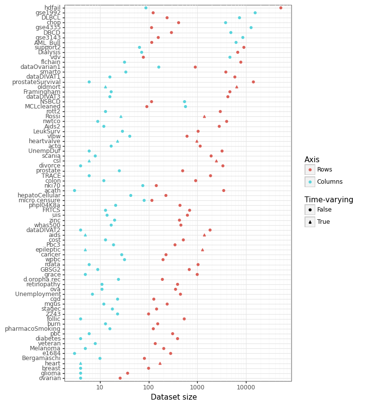
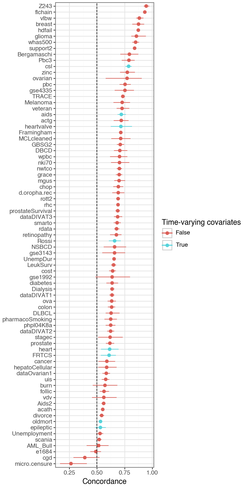

# SurvSet: An open-source time-to-event dataset respository

[`SurvSet`](https://arxiv.org/pdf/2203.03094.pdf) is the first ever open-source time-to-event dataset repository. The goal of `SurvSet` is to allow researchers and practioneeres to benchmark machine learning models and assess statistical methods. All datasets in this repository are consisently formatted to enable rapid prototyping and inference. The origins of this dataset were for testing regularity conditions of the [False Positive Control Lasso](https://arxiv.org/abs/1903.12584).

`SurvSet` currently has 77 datasets (8 of which are time-varying) which vary in dimensionality (see figure below). This includes high-dimensional genomics datasets (p >> n) like `gse1992`, and long and skinny datasets like `hdfail` (n >> p). 

See the [Changelog](CHANGELOG.md)

## Installation

`SurvSet` can be installed using `pip` for `python3`: `pip install SurvSet`. You can run `python3 -m SurvSet` to make sure the package has compiled without errors. Please note that `pandas` and `numpy` will be installed as dependencies (see [PyPI](https://pypi.org/project/SurvSet/) for more details).

**Note:** Installing from Git refs (e.g., `git+https://github.com/ErikinBC/SurvSet.git@main`) does not include packaged dataset resources. For full functionality, install from [PyPI](https://pypi.org/project/SurvSet/) instead.   

## Dataset structure and origin

Most of `SurvSet`'s datasets come from existing `R` packages. The accompanying [arXiv paper](https://arxiv.org/pdf/2203.03094.pdf) provides a full list of package sources and references. Datasets can be called in from the main class `SurvLoader` with the `load_dataset` method. This will return a `pandas` DataFrame with the following columns structure:

1. `pid`: the unique observation identifier (especially relevant for time-varying datasets)
2. `event`: a binary event indicator (1==event has happened) 
3. `time`: time to event/censoring (or start time if `time2` exists)
4. `time2`: end time [`time`, `time2`) if there are time-varying features
5. `num_{}`: prefix implies a continuous feature
6. `fac_{}`: prefix implies a categorical feature

Currently, 8 datasets have time-varying features. Some datasets will have the same feature a both a continuous and categorical feature. This was done for those features that are plausibly ordinal.

### Figure: Dataset dimensionality



### Table: Datasets by application field

Survival analysis grew out of clinical research, and so did most of `SurvSet`: 69 of the 77 datasets are clinical/medical (37 of them oncology, including all the high-dimensional gene-expression datasets). The rest come from economics, social science or engineering, or have no documented provenance. Each dataset was classified from its source documentation (see the `ref` returned by `load_dataset`). A machine-readable version is in [`SurvSet/_datagen/figures/df_domain.csv`](SurvSet/_datagen/figures/df_domain.csv).

| Application field | Group | # datasets |
|---|---|---:|
| Oncology | Clinical / medical | 37 |
| Cardiology | Clinical / medical | 8 |
| Transplant / Nephrology | Clinical / medical | 5 |
| Infectious disease | Clinical / medical | 4 |
| Hepatology | Clinical / medical | 3 |
| Neurology | Clinical / medical | 2 |
| Critical care | Clinical / medical | 3 |
| Other clinical | Clinical / medical | 7 |
| Economics | Non-medical | 2 |
| Social science | Non-medical | 4 |
| Engineering / reliability | Non-medical | 1 |
| Other / unspecified | Unspecified | 1 |
| **Total** | | **77** |

<details>
<summary>Full list of datasets by field (click to expand)</summary>

| Field | Dataset | Sub-field / description |
|---|---|---|
| Oncology | `prostateSurvival` | Prostate cancer |
| Oncology | `nwtco` | Wilms tumour (paediatric) |
| Oncology | `rott2` | Breast cancer (Rotterdam) |
| Oncology | `LeukSurv` | Acute myeloid leukaemia |
| Oncology | `colon` | Colon cancer adjuvant trial |
| Oncology | `dataOvarian1` | Ovarian cancer relapse (gene expression) |
| Oncology | `GBSG2` | Breast cancer (German BCSG trial) |
| Oncology | `follic` | Follicular lymphoma |
| Oncology | `prostate` | Prostate cancer |
| Oncology | `phpl04K8a` | Lung adenocarcinoma (Shedden et al., gene expression) |
| Oncology | `zinc` | Esophageal cancer & tissue zinc (Linxian trial) |
| Oncology | `chop` | DLBCL treated with CHOP (gene expression) |
| Oncology | `ova` | Ovarian cancer |
| Oncology | `DBCD` | Breast cancer (Dutch, gene expression) |
| Oncology | `e1684` | Melanoma (ECOG 1684) |
| Oncology | `mgus` | Monoclonal gammopathy (MGUS) |
| Oncology | `DLBCL` | Diffuse large B-cell lymphoma (gene expression) |
| Oncology | `cancer` | Lung cancer (NCCTG) |
| Oncology | `hepatoCellular` | Hepatocellular carcinoma |
| Oncology | `Melanoma` | Malignant melanoma |
| Oncology | `wpbc` | Breast cancer (Wisconsin prognostic) |
| Oncology | `d.oropha.rec` | Oropharyngeal carcinoma |
| Oncology | `gse3143` | Breast cancer (GSE3143, gene expression) |
| Oncology | `stagec` | Prostate cancer (stage C) |
| Oncology | `nki70` | Breast cancer (NKI 70-gene) |
| Oncology | `veteran` | Lung cancer (VA trial) |
| Oncology | `gse1992` | Breast cancer (GSE1992, gene expression) |
| Oncology | `micro.censure` | Rectal cancer (microsatellite allelotyping) |
| Oncology | `AML_Bull` | Acute myeloid leukaemia (Bullinger, gene expression) |
| Oncology | `NSBCD` | Breast cancer (Norway/Stanford, gene expression) |
| Oncology | `gse4335` | Breast cancer (GSE4335, gene expression) |
| Oncology | `breast` | Breast cancer |
| Oncology | `MCLcleaned` | Mantle cell lymphoma (gene expression) |
| Oncology | `Bergamaschi` | Breast cancer (gene expression) |
| Oncology | `vdv` | Breast cancer (van 't Veer 70-gene, gene expression) |
| Oncology | `glioma` | Glioma (brain tumour) |
| Oncology | `ovarian` | Ovarian cancer trial |
| Cardiology | `Framingham` | Framingham heart study |
| Cardiology | `smarto` | Arterial disease (SMART) |
| Cardiology | `acath` | Coronary catheterisation (Duke) |
| Cardiology | `FRTCS` | Blood-pressure / hypertension |
| Cardiology | `TRACE` | Post-MI (TRACE) |
| Cardiology | `grace` | Acute coronary syndrome (GRACE) |
| Cardiology | `heartvalve` | Heart-valve surgery |
| Cardiology | `whas500` | Worcester heart-attack study |
| Transplant / Nephrology | `Dialysis` | Dialysis patients |
| Transplant / Nephrology | `dataDIVAT1` | Kidney transplant (DIVAT) |
| Transplant / Nephrology | `dataDIVAT3` | Kidney transplant (DIVAT) |
| Transplant / Nephrology | `dataDIVAT2` | Kidney transplant (DIVAT) |
| Transplant / Nephrology | `heart` | Stanford heart transplant |
| Infectious disease | `Aids2` | AIDS survival (Australia) |
| Infectious disease | `aids` | AIDS cohort |
| Infectious disease | `actg` | HIV trial (ACTG 320) |
| Infectious disease | `cgd` | Chronic granulomatous disease |
| Hepatology | `csl` | Liver cirrhosis (CSL) |
| Hepatology | `Pbc3` | Primary biliary cirrhosis (PBC3) |
| Hepatology | `pbc` | Primary biliary cirrhosis |
| Neurology | `epileptic` | Epilepsy drug trial |
| Neurology | `cost` | Stroke (Copenhagen) |
| Critical care | `support2` | Seriously-ill hospitalised (SUPPORT) |
| Critical care | `rhc` | Right-heart catheterisation |
| Critical care | `burn` | Burn-unit patients |
| Other clinical | `flchain` | Serum free light chain & mortality |
| Other clinical | `uis` | Drug-relapse (UIS) |
| Other clinical | `vlbw` | Very-low-birth-weight neonates |
| Other clinical | `retinopathy` | Diabetic retinopathy (survival) |
| Other clinical | `diabetes` | Diabetic retinopathy (timereg) |
| Other clinical | `pharmacoSmoking` | Smoking-cessation trial |
| Other clinical | `Z243` | Hospital length of stay, medical back problems (Swiss DRG 243) |
| Economics | `UnempDur` | Unemployment duration (US) |
| Economics | `Unemployment` | Unemployment spells |
| Social science | `oldmort` | Old-age mortality (demography) |
| Social science | `divorce` | Divorce / marriage duration |
| Social science | `scania` | Historical mortality (Scania) |
| Social science | `Rossi` | Criminal recidivism |
| Engineering / reliability | `hdfail` | Hard-disk failure |
| Other / unspecified | `rdata` | Relative-survival example data (relsurv); provenance not documented |

</details>


# Usage (simple)

Print the list of datasets that can be loaded and load the `ova` dataset.

```python
from SurvSet.data import SurvLoader
loader = SurvLoader()
# List of available datasets and meta-info
print(loader.df_ds.head())
# Load dataset and its reference
df, ref = loader.load_dataset(ds_name='ova').values()
print(df.head())
```

# Usage (complex)

The example below shows a sketch of what a machine learning might look like using an ElasticNet CoxPH model to a non-time-varying dataset, and a traditional CoxPH to a time-varying one. 

```python
# Modules needed for fitting
import pandas as pd
from sksurv.util import Surv
from lifelines import CoxTimeVaryingFitter
from sksurv.linear_model import CoxnetSurvivalAnalysis
from sklearn.pipeline import Pipeline
from sklearn.impute import SimpleImputer
from sklearn.preprocessing import OneHotEncoder, StandardScaler
from sklearn.compose import make_column_selector, ColumnTransformer
# Set up the dataset loader
from SurvSet.data import SurvLoader
loader = SurvLoader()

# (i) Set up a pipeline to handle numerical (possibly missing) and categorical features 
enc_fac = Pipeline(steps=[('ohe', OneHotEncoder(drop=None,sparse_output=False, handle_unknown='ignore'))])
sel_fac = make_column_selector(pattern='^fac\\_')
enc_num = Pipeline(steps=[('impute', SimpleImputer(strategy='median')), 
                        ('scale', StandardScaler())])
sel_num = make_column_selector(pattern='^num\\_')
enc_df = ColumnTransformer(transformers=[('ohe', enc_fac, sel_fac),('s', enc_num, sel_num)])
enc_df.set_output(transform='pandas')

# (ii) Non-time-varying dataset (prostate)
df_prostate = loader.load_dataset(ds_name='prostate')['df']
# Set up data and model
senc = Surv()
So = senc.from_arrays(df_prostate['event'].astype(bool), df_prostate['time'])
enc_df.fit(df_prostate)
X_train = enc_df.transform(df_prostate)
mdl = CoxnetSurvivalAnalysis(n_alphas=50)
# Fit and predict
mdl.fit(X=X_train, y=So)
# Select optimal alpha based on training score
best_alpha = mdl.alphas_[np.argmax([mdl.score(X_train, So, alpha=alpha) for alpha in mdl.alphas_])]
mdl.predict(X_train, alpha=best_alpha)

# (ii) Load a time-varying dataset (epileptic)
df_epileptic = loader.load_dataset(ds_name='epileptic')['df']
# Set up data and model
mdl = CoxTimeVaryingFitter(penalizer=0.1)
enc_df.fit(df_epileptic)
X_train = enc_df.transform(df_epileptic)
X_train = pd.concat(objs=[df_epileptic[['pid','event','time','time2']], X_train], axis=1)

# Fit and predict
mdl.fit(X_train, id_col="pid", event_col="event", start_col="time", stop_col="time2", show_progress=False)
# Get test prediction
mdl.predict_partial_hazard(X_train)
```

See the [simulation](simulation/__main__.py) script for how to generate test-set concordance-index scores, which are highlighted below.





## Making changes to the package

If you are interested in contributing to `SurvSet` or know of other open-source time-to-event datasets you think would be useful additions, feel free to make a fork of the repo or a PR.

### Environment set up

You can start by creating a virtual environment to align with the development environment.

1. `python -m venv surv`
2. `pip install -r requirements.txt`
3. `source surv/bin/activate`

### Pre-merge install smoke test

Before merging a packaging-related fix, run a clean install smoke test from a Git ref:

1. `scripts/smoke_install_ref.sh main`
2. `scripts/smoke_install_ref.sh <branch-or-commit>`

This creates a temporary virtual environment, installs `SurvSet` from the specified ref, and runs `python -m SurvSet`.

### How to add a new package/dataset

The SurvSet._datagen module will generate the underlying raw data and process it. There are currently two ways to add a dataset:

1. SurvSet/_datagen/download_pkgs.py: Will leverage existing R packages, which you can add to the `di_pkgs` dictionary in the SurvSet/_datagen/utils/funs_pkgs.py file (these will be stored locally in the ..utils/pkgs folder).
2. For all others, they are manually describe in the SurvSet/_datagen/download_custom file.py and stored in the ..utils/custom folder.

After the file download script is completed, a class will need to added to the datasets.py file in either the Rprocess or Cprocess folders. See the existing examples to align the required method/class structure (should be intuitive). Next, in the corresponding __init__.py file for R/CProcess, add your new class and corresponding methods/file-names. This will be called in by the process_datasets.py script to write a new pickle file. 


## How to cite

If you use `SurvSet` in your research or project please cite the following: 

```
@article{drysdale2022,
  title={{SurvSet}: An open-source time-to-event dataset repository},
  author={Drysdale, Erik},
  journal={arXiv preprint arXiv:2203.03094},
  year={2022}
}
```